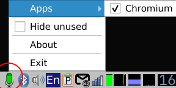

# QMicMonitor

**QMicMonitor** is a lightweight, privacy-focused open-source Linux utility built with Qt5/Qt6 and native PipeWire (`libpipewire`). It monitors microphone (audio input) usage by applications in real-time and triggers custom actions or scripts when a monitored application stops recording.

## Features

* **Real-time Microphone Tracking:** Leverages native PipeWire registry events for low-overhead audio stream detection.
* **Process Identification:** Extracts and displays the Application Name, Node Name, and exact Process ID (PID) for every recording session.
* **Custom Disconnect Actions:** Instantly execute custom C++ code, system alerts, or external bash scripts upon microphone disconnection.
* **Qt5/Qt6 Ready:** Designed to integrate seamlessly into modern Linux desktop environments as a system tray icon or background daemon.

## Prerequisites

To build and run **QMicMonitor**, you need a Linux system with PipeWire and the Qt5/Qt6 development environment installed.

### How it works:
1. The application hooks into the PipeWire IPC registry.
2. When a target app starts using the microphone (registers a `Stream/Input/Audio` node), `QMicMonitor` captures its PID and name.
3. Once the app releases the microphone or closes, the disconnect trigger fires immediately.

### screenshot

## Acknowledgments

* The [PipeWire](https://pipewire.org) team for their amazing modern multimedia framework.
* The [The Qt Company](https://qt.io) for the cross-platform application framework.
